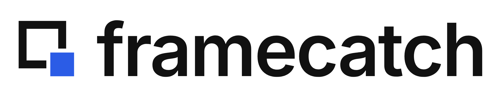

<p align="center">
  <picture>
    <source media="(prefers-color-scheme: dark)" srcset="assets/framecatch-logo-white.png">
    
  </picture>
</p>

# Framecatch

Framecatch is an open-source tool that captures your entire screen with the press of a hotkey.

**Status:** Early development. Core features are still being built.

## Features

- Global hotkey listener with a multi-action registry
- Active-screen capture at full physical resolution
- Multi-monitor support based on cursor position
- Timestamped PNG save to Desktop

More features (for example, region capture and recording) are planned, although for now the focus is on the core fundamentals.

## Installation

Coming soon.

## Usage

1. Run the app with `npm run dev`.
2. Focus any other app.
3. Press `CommandOrControl+Shift+S`.
4. Open the new `framecatch-<timestamp>.png` file on the Desktop.

## Development

### Prerequisites

- [Node.js](https://nodejs.org/) (LTS)

### Run

```
npm install
npm run dev
```

## Contributing

Ideas, bug reports, and pull requests are welcome. Please read [CONTRIBUTING.md](CONTRIBUTING.md) before opening a pull request. If you have any issues with the project, feel free to open an issue.

## License

MIT
